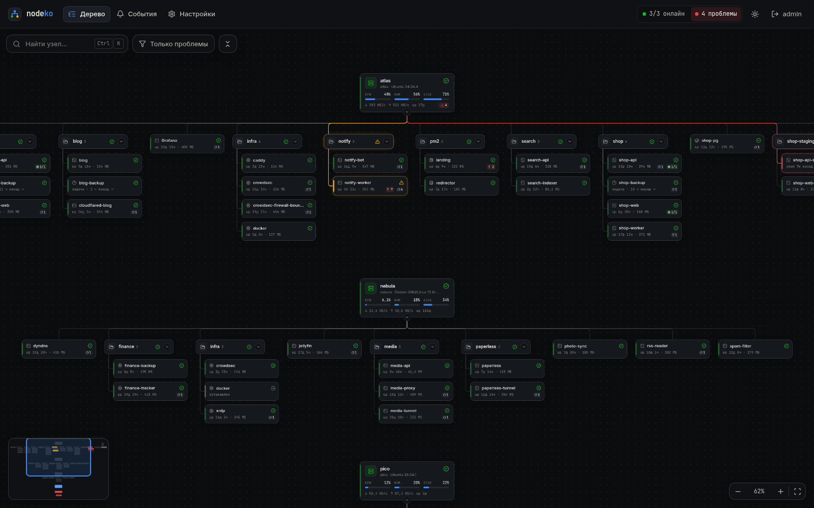
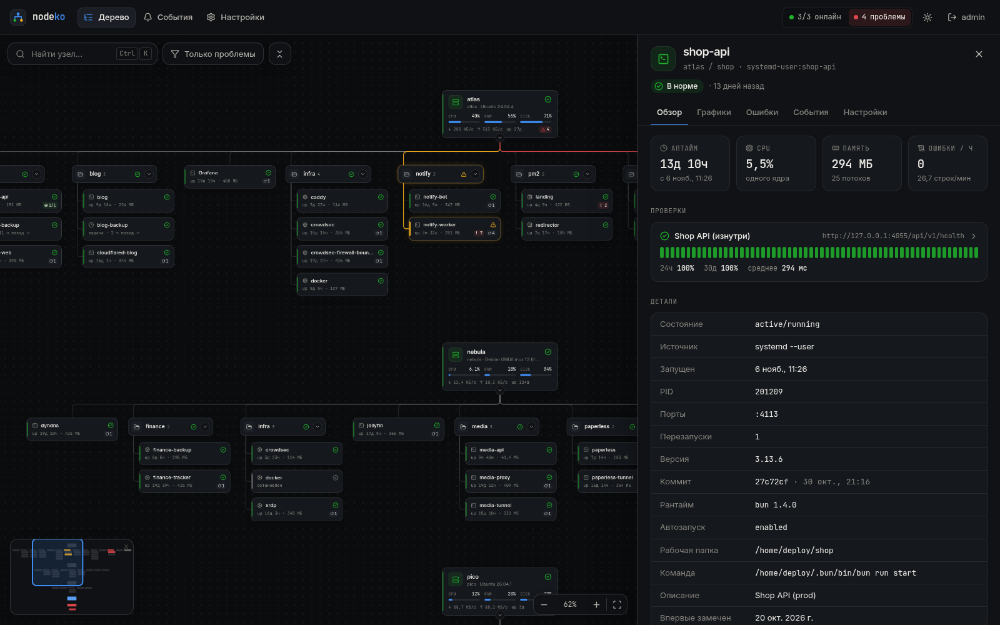
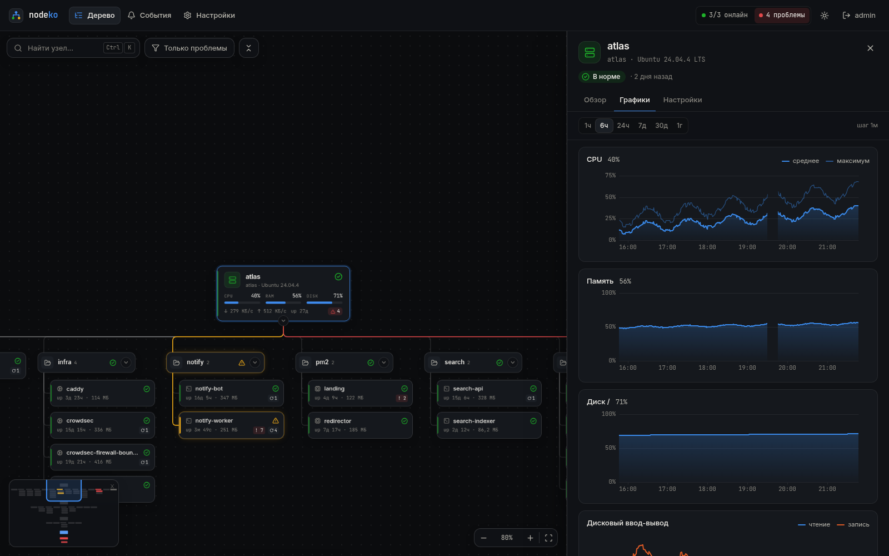
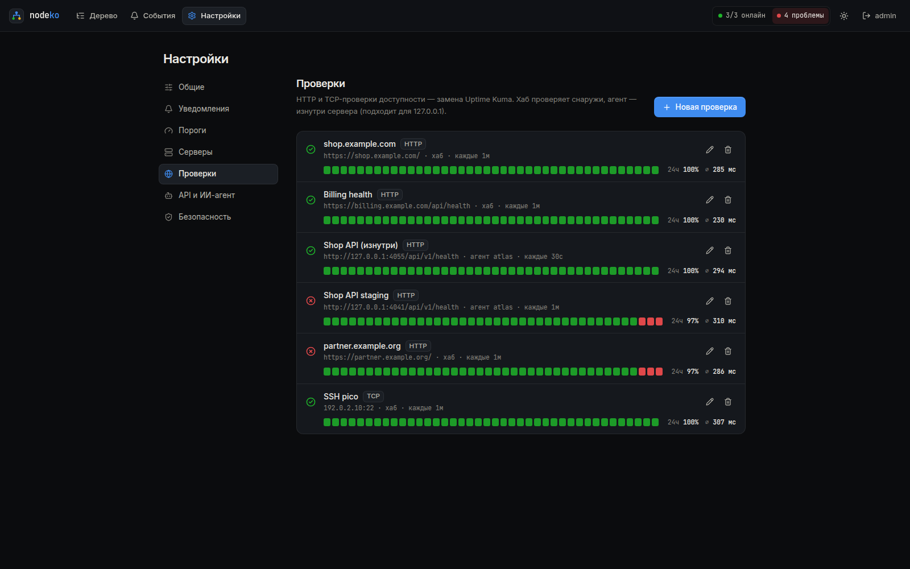
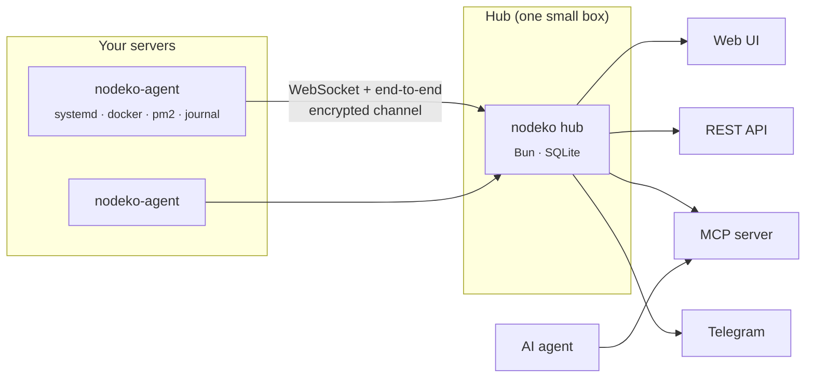

<div align="center">


# nodeko

**Self-hosted monitoring for your servers and the services running on them — drawn as a tech tree.**

A small, opinionated replacement for *Uptime Kuma + Beszel*, built for one human and their AI agent.

[](https://bun.sh)
[](https://www.typescriptlang.org)
[](https://react.dev)
[](https://modelcontextprotocol.io)
[](LICENSE)

</div>

<p align="center">
  
</p>

> **nodeko** = *node* + *neko*. She watches your boxes at night so you don't have to.

## Why

Uptime Kuma tells you a URL is down. Beszel tells you a box is hot. Neither tells you *which systemd unit
on which server* just crashed, what version it was running, or what it printed before dying.

nodeko puts all of that on one canvas: every server is a root node, every service hangs off it, and each
node shows its health at a glance. Click a node for the details — charts, uptime, version, commit, ports,
recent errors, events. It deliberately does nothing else.

## Features

- **Tech-tree home page** — servers → groups → services. Drag to pan, scroll to zoom, minimap, `Ctrl+K`
  search, "problems only" filter. Groups are derived from name prefixes (`shop-api`, `shop-web` → `shop`)
  or set by hand.
- **Host metrics** — CPU, load, RAM, swap, every real filesystem, disk I/O, network throughput and
  traffic, internet latency, uptime. History is rolled up automatically: raw points (48 h) → 1-minute
  (30 days) → 15-minute (400 days); all retention is configurable.
- **Service discovery, zero config** — systemd system *and* user units, Docker containers, pm2 processes.
  Per service: state, uptime, restarts, CPU/RAM, ports, version (`package.json`, image tag, distro
  package), git commit, runtime (`bun`/`node`), working directory and command.
- **Error capture** — new journal lines that look like errors (configurable regex, or priority `err` and
  above) are collected per service, with an hourly histogram.
- **Uptime checks** — HTTP(S) (status codes, keyword, TLS certificate expiry) and TCP, run from the hub
  *or* from inside any server (so `http://127.0.0.1:…` works). Kuma-style heartbeat bars.
- **Sensible statuses** — `ok · warn · down · stopped · unknown · pending`. Crash loops, failed jobs,
  disabled-but-stopped units and missing units are told apart; down alerts are debounced so a quick
  restart doesn't page you.
- **Telegram notifications** — server offline, service down, check failed, thresholds (CPU, RAM, disk),
  recovery, expiring certificates. Each kind can be switched off.
- **Built for AI agents** — a full REST API and an **MCP server** (13 tools) so an agent can read
  everything *and* configure nodeko itself: rename and group services, add checks, tune thresholds.
- **Production-grade UI** — dark and light themes, responsive down to phone width, charts by uPlot.

<table>
  <tr>
    <td width="50%"></td>
    <td width="50%"></td>
  </tr>
  <tr>
    <td align="center"><sub>Service details: uptime, resources, checks, version and commit</sub></td>
    <td align="center"><sub>Server history: CPU, memory, disks, network, latency</sub></td>
  </tr>
</table>

<p align="center">
  <br />
  <sub>HTTP/TCP checks with heartbeat bars, uptime and latency</sub>
</p>

> [!NOTE]
> The web interface is currently in **Russian**. The API, the MCP tool descriptions for agents and this
> README are what you'd expect; translations are welcome.

## How it works



- **Hub** (`src/hub`) — a single Bun process with an embedded SQLite database. It receives snapshots,
  keeps history, derives statuses, runs checks, sends notifications and serves the UI, the API and MCP.
- **Agent** (`src/agent`) — one self-contained binary per server (`linux-x64`, `linux-arm64`). It runs as
  an unprivileged systemd **user** unit, reads the system and pushes a snapshot every 10 seconds.
- **Web** (`web`) — React 19, Vite, Tailwind CSS 4, TanStack Query, uPlot.

## Security

nodeko is meant to be exposed to the internet, so the agent ↔ hub link does not rely on TLS alone.

- **Mutually authenticated, end-to-end encrypted channel** on top of the WebSocket
  ([`src/shared/secure.ts`](src/shared/secure.ts)): both sides sign the handshake with Ed25519, keys are
  derived from ephemeral X25519 (forward secrecy) via HKDF, frames are AES-256-GCM with a strict counter
  — replayed, reordered or dropped frames kill the connection.
- **The agent pins the hub's public key** at install time, so a compromised proxy or TLS terminator in
  between can neither read the data nor impersonate the hub.
- **One-time enrollment tokens** (24 h). After that an agent is identified only by its own key.
- **The agent is read-only by design.** It never executes anything it receives from the hub; the hub can
  only send declarative config (interval, check definitions, log pattern). Everything the hub receives
  from agents is treated as untrusted input and sanitised.
- **Web login** — username + password (argon2id, rate-limited) and **passkeys** (WebAuthn). Sessions are
  `__Host-` cookies (HttpOnly, SameSite=Strict); state-changing requests require a matching `Origin` and
  a JSON body. Strict CSP, no third-party assets.
- **API tokens** are scoped `read` or `admin` and stored hashed. Tokens, passkeys, sessions and the
  password can only be managed from a logged-in browser — never with a token.
- The hub listens on `127.0.0.1` only; put it behind a reverse proxy or a Cloudflare Tunnel.

## Quick start

### 1. Hub

Requirements: Linux with systemd, [Bun](https://bun.sh) ≥ 1.4, a domain behind a reverse proxy with
WebSocket support (Caddy, nginx, Cloudflare Tunnel, …) pointing at `127.0.0.1:4170`.

```sh
git clone https://github.com/nyandaryn/nodeko.git ~/nodeko && cd ~/nodeko
bun install
bun run build                     # web UI + agent binaries for x64 and arm64

mkdir -p ~/.config/nodeko ~/.config/systemd/user
cp deploy/hub/hub.env.example ~/.config/nodeko/hub.env     # set NODEKO_PUBLIC_URL
cp deploy/hub/nodeko-hub.service ~/.config/systemd/user/
systemctl --user daemon-reload && systemctl --user enable --now nodeko-hub
loginctl enable-linger "$USER"    # keep user services running after logout

bun run admin user:create admin --generate                 # prints the password
```

The unit expects the checkout in `~/nodeko` and Bun in `~/.bun/bin` — adjust `WorkingDirectory` and
`ExecStart` otherwise. Open your domain, sign in, and add a passkey under **Settings → Security**
(*Настройки → Безопасность*) if you like.

### 2. Agents

In the UI go to **Settings → Servers → Add server** (*Настройки → Серверы → Добавить сервер*). You get a
one-line command with a one-time token:

```sh
curl -fsSL https://nodeko.example.com/install/agent.sh | sh -s -- --server web-1 --token ne_…
```

Run it on the server as the user that owns your apps (or as root for a sandboxed system unit). The script
verifies the binary's SHA-256, pins the hub key and installs a systemd unit. To update an agent later, run
the same command without `--server` and `--token`.

> Without root the agent sees the system journal only if its user can read it (`systemd-journal` or `adm`
> group), and sees listening ports only for its own processes. Docker needs access to the Docker socket.

### 3. Your AI agent

Create an `admin` token under **Settings → API & AI agent** (*Настройки → API и ИИ-агент*), then:

```sh
claude mcp add --transport http nodeko https://nodeko.example.com/mcp \
  --header "Authorization: Bearer nk_…"
```

Any MCP client with Streamable HTTP support works. Plain REST is available too; agent-oriented docs are
served at `GET /api/v1/docs`, and the full contract lives in [`src/shared/api.ts`](src/shared/api.ts).

## Configuration

Environment variables of the hub (`~/.config/nodeko/hub.env`):

| Variable | Default | |
|---|---|---|
| `NODEKO_PUBLIC_URL` | `http://localhost:4170` | Public URL: agent install commands, links in notifications, passkey RP ID |
| `NODEKO_HOST` / `NODEKO_PORT` | `127.0.0.1` / `4170` | Listen address |
| `NODEKO_DATA` | `~/.local/share/nodeko` | Database and the hub key (`hub.key` — back it up, agents pin it) |
| `NODE_ENV` | — | `production` enables `__Host-` cookies and HSTS |

Everything else — snapshot interval, thresholds, retention, notifications, the error pattern — is set in
the UI or through the API/MCP.

### Admin CLI

```sh
bun run admin user:create <login> [--generate]   # password from stdin or generated
bun run admin user:password <login> [--generate]
bun run admin token:create <name> [--scope read|admin]
bun run admin token:list
bun run admin token:revoke <id|name>
bun run admin server:add <id> [name]             # enrollment token + install command
bun run admin sessions:revoke                    # sign out everywhere
bun run admin hub:key                            # hub public key and fingerprint
```

## Development

```sh
bun install
PORT=4179 bun scripts/mock-hub.ts                               # fake API with realistic data
NODEKO_DEV_HUB=http://127.0.0.1:4179 bun run dev:web            # http://localhost:5173, admin / admin
```

Against a real local hub: `bun run dev:hub` (data in `./data`), `bun run dev:web`, and create a user with
`NODEKO_DATA=./data bun run admin user:create admin --generate`.

```sh
bun test && bun run typecheck && bun run build                  # before every release
```

| Path | |
|---|---|
| `src/shared/` | Wire protocol, secure channel, REST contract, check runner |
| `src/hub/` | Ingest, statuses, checks, notifications, rollups, HTTP, auth, MCP, CLI |
| `src/agent/` | Collectors (system, systemd, docker, pm2, journal, versions, ports) |
| `web/` | React UI |
| `deploy/` | Agent installer, hub systemd unit and deploy script |

<p align="center">
  
</p>

## License

[MIT](LICENSE) © nyandaryn
